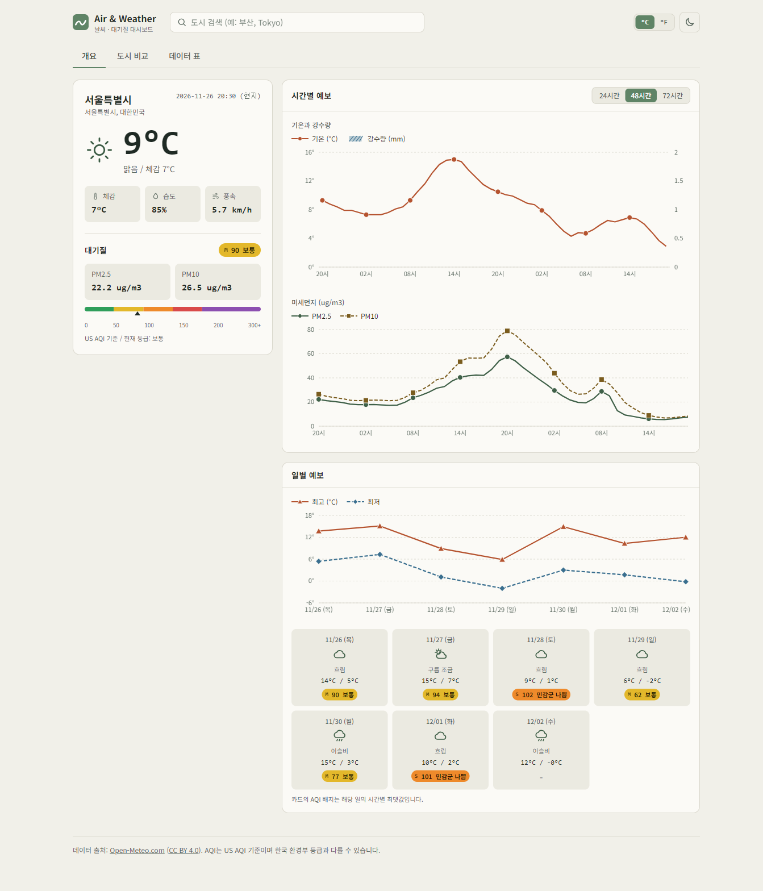
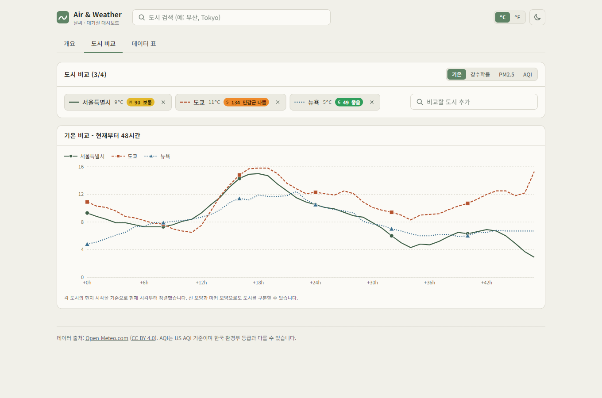
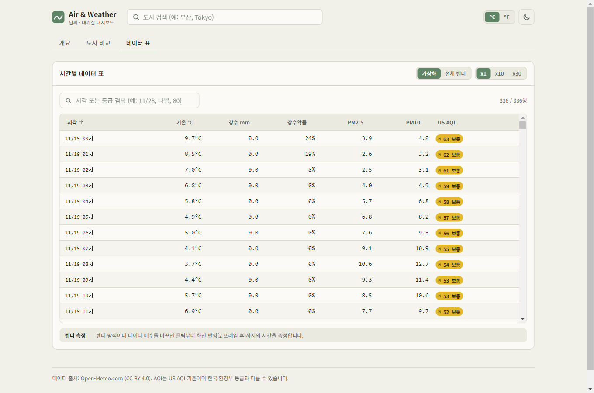
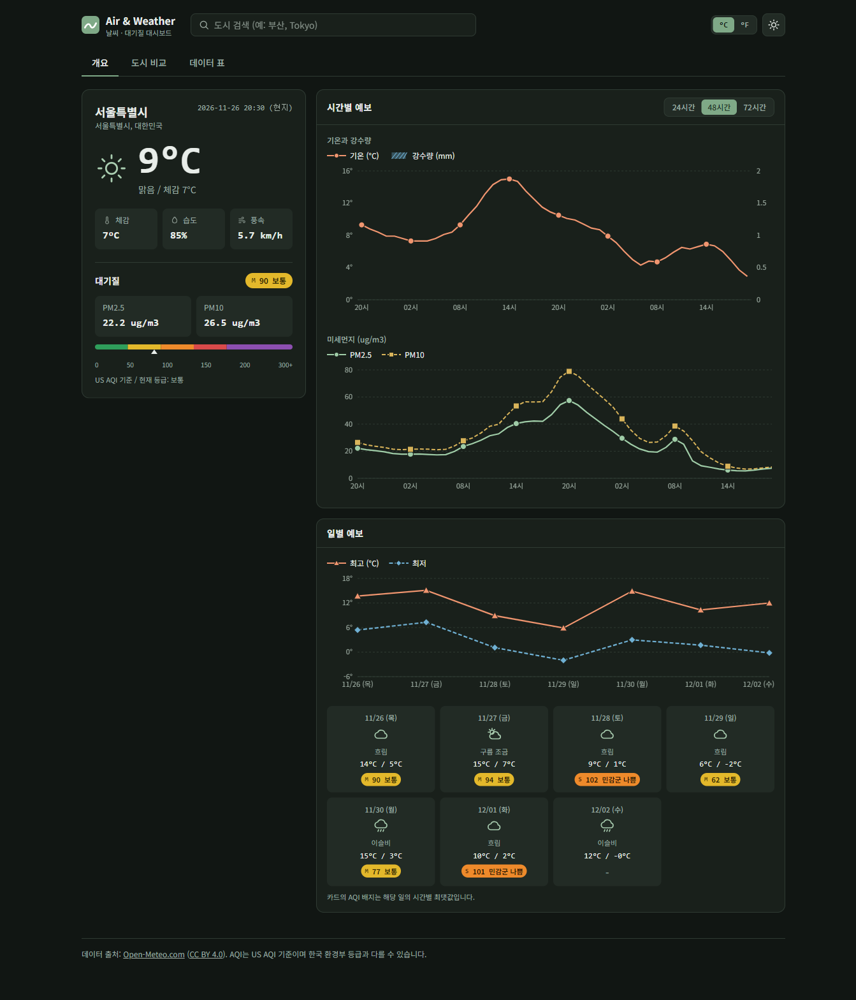

# Air & Weather Dashboard

Open-Meteo 데이터를 시각화하는 날씨·대기질 대시보드. 시계열 차트, 다중 도시 비교, 수천 행 가상화 표를 백엔드 없이 구현했습니다.

**Live Demo:** https://minhahamin.github.io/air-weather-dashboard/



| 도시 비교 | 데이터 표 (가상화) | 다크 모드 |
| --- | --- | --- |
|  |  |  |

## 한눈에 보기

| 항목 | 내용 |
| --- | --- |
| 프로젝트 목적 | 데이터 시각화, 대량 데이터 렌더링 성능, UI 구현력을 보여주는 프론트엔드 포트폴리오 |
| 개발 기간 | 1인 개발 (기간은 직접 기입: `____`) |
| 담당 | 기획, 디자인, 개발 전부 1인 |
| 핵심 역량 | 시각화 (Recharts 커스텀 툴팁, 색 외 구분 수단), 성능 최적화 (가상화 전후 직접 측정) |

## 주요 기능

- **도시 검색**: Open-Meteo Geocoding, 300ms 디바운스, 키보드 조작(방향키/Enter/Esc) 지원. 최근 검색 도시와 마지막 선택 도시를 localStorage에 저장하고 기본 도시는 서울
- **현재 상태 요약 카드**: 기온, 체감, 습도, 풍속, PM2.5, PM10, US AQI. 등급은 색 + 기호 + 등급명을 함께 표기
- **시간별/일별 예보 차트**: 기온·강수량(24/48/72시간), PM2.5·PM10 추이, 일별 최고/최저. 커스텀 툴팁, 반응형
- **다중 도시 비교**: 2~4개 도시를 한 차트에 오버레이. 기온, 강수확률, PM2.5, AQI 중 지표 선택. 도시마다 선 모양(실선/점선)과 마커 모양(원/사각/삼각/마름모)이 달라 색을 구분하지 못해도 읽을 수 있음
- **가상화 데이터 표**: 과거 7일 + 예보 7일 = 336행의 시간별 데이터를 `@tanstack/react-virtual`로 렌더링. 컬럼 정렬, 검색(시각/AQI 등급/AQI 숫자), 가상화 on/off와 데이터 배수(x1/x10/x30) 전환 및 렌더 시간 측정 패널 내장
- **기타**: 섭씨/화씨 전환, 다크모드(시스템 설정 기본), 로딩 스켈레톤, 에러/빈 상태, 대기질 API 실패 시 날씨만 표시(부분 실패 허용)

## 기술 스택과 선택 이유

| 기술 | 선택 이유 |
| --- | --- |
| Vite + React 19 + TypeScript(strict) | 빠른 개발 환경, `noUncheckedIndexedAccess`까지 켠 엄격한 타입으로 null 가능한 API 값을 컴파일 단계에서 강제 처리 |
| Tailwind CSS v4 | 의미 기반 CSS 변수(토큰)를 `@theme`에 연결해 라이트/다크를 변수 교체만으로 전환 |
| TanStack Query | 캐싱(10분 stale), 요청 취소, 다중 도시 병렬 조회(`useQueries`), 로딩/에러 상태 일원화 |
| Recharts | 선언적 API로 커스텀 툴팁/마커/패턴 확장이 쉬움. 데이터가 수백 점 수준이라 SVG로 충분하다고 판단 |
| @tanstack/react-virtual | 수천 행 표의 DOM 수를 일정하게 유지 |
| Vitest + Testing Library | Vite 설정 공유, 핵심 로직과 주요 컴포넌트 동작 검증 |

## 기술적 도전과 해결

### 1. 수천 행 표 렌더링이 느려지는 문제

- **문제**: 시간별 데이터 336행을 전부 렌더링하면 데이터가 늘어날수록 표 전환이 눈에 띄게 느려진다.
- **원인**: 행마다 AQI 배지 등 하위 DOM이 있어 보이지 않는 행까지 모두 DOM 노드로 만들고 레이아웃을 계산한다.
- **해결**: `useVirtualizer`로 뷰포트 + overscan(8행)만 렌더링하고 나머지는 전체 높이 스페이서로 대체. 고정 행 높이(36px)를 사용해 측정 비용을 없앴고, `role="table"`/`aria-rowcount`/`aria-rowindex`로 접근성 의미를 유지. 비교를 위해 "전체 렌더" 모드를 앱 안에 남기고 렌더 시간 측정 패널을 만들었다.
- **결과**: 아래 [성능 측정](#가상화-성능-측정)에서 직접 측정. 프로덕션 빌드 기준 x30(10,080행)에서 중앙값 12ms vs 3,777ms.

### 2. 날씨 API와 대기질 API의 시계열이 어긋나는 문제

- **문제**: 두 API가 각각 반환하는 시간 배열을 인덱스로 합치면 값이 엇갈릴 수 있다. 대기질 API는 요청과 다른 범위/결측(null)을 줄 수 있다.
- **원인**: 두 API의 시간 범위와 길이가 항상 같다는 보장이 없다.
- **해결**: ISO 시각 문자열을 키로 하는 Map으로 병합(`mergeHourly`)하고, 없는 값은 `null`로 둔다. 정렬 시 null은 방향과 무관하게 항상 뒤로 보낸다. 대기질 API만 실패해도 날씨는 표시되도록 `airAvailable` 플래그로 부분 실패를 처리. 모두 단위 테스트로 고정했다.
- **결과**: 실제 응답에서 마지막 날 대기질이 비는 경우에도 화면이 깨지지 않고 "-"로 표시된다.

### 3. 타임존이 다른 도시를 한 차트에서 비교

- **문제**: 서울, 도쿄, 뉴욕은 현지 시각이 달라 시각 축으로 겹치면 의미가 없다.
- **원인**: Open-Meteo `timezone=auto`는 도시별 현지 시각을 반환한다.
- **해결**: 각 도시의 `current.time` 기준으로 현재 시각 이후 48시간을 잘라(`sliceFromNow`) "현재 +N시간" 축으로 정렬. 툴팁 하단에 각 도시의 현지 시각을 함께 표시.
- **결과**: 시차와 무관하게 "지금부터의 추이"를 비교할 수 있다. (같은 절대 시각 기준 비교는 구현하지 않았음)

### 4. 색에 의존하지 않는 차트와 의미 색 유지

- **문제**: 다중 시리즈 차트와 AQI 등급이 색 구분에 의존하면 색각 이상 사용자가 읽기 어렵다.
- **해결**: 시리즈마다 선 모양과 마커 모양을 다르게 하고, 막대는 빗금 패턴을 사용하며 범례에 같은 기호를 표시한다. AQI는 US AQI 6단계 의미 색을 유지하되 기호(G/M/S/U/V/H)와 등급명을 항상 함께 표기한다. 테마 포인트 색(세이지 그린)과 AQI 의미 색은 분리했다.
- **결과**: 흑백으로 봐도 시리즈와 등급을 구분할 수 있다. (보조기기 사용자 테스트는 하지 않았음)

## 가상화 성능 측정

앱의 "데이터 표" 탭 상단에서 직접 재현할 수 있습니다.

- **측정 방법**: 렌더 방식 또는 데이터 배수 버튼 클릭 시점부터 커밋 후 `requestAnimationFrame` 2회가 지난 시점까지의 시간(`performance.now()`)을 화면 하단에 표시. 네트워크 시간은 포함되지 않음. x1은 336행 원본, x10/x30은 같은 데이터를 복제해 3,360/10,080행으로 만든 부하 테스트
- **자동화**: Playwright(Chromium)로 각 조건을 7회 반복, 매 회 x1 상태에서 전환 후 측정. 중앙값 사용
- **환경**: 개발자 로컬 PC(Windows 11), 프로덕션 빌드(`vite preview`). CPU/메모리 사양은 기록하지 않음. 값은 환경에 따라 달라지므로 상대 비교로 보세요

| 조건 (x1에서 전환) | 렌더 방식 | DOM 행 수 | 중앙값 (최소 ~ 최대) |
| --- | --- | --- | --- |
| 336행 (가상화 -> 전체 렌더 전환) | 전체 렌더 | 336 | 159 ms (134 ~ 200) |
| 3,360행 (x10) | 가상화 | 22 | 14 ms (9 ~ 16) |
| 3,360행 (x10) | 전체 렌더 | 3,360 | 1,571 ms (1,395 ~ 1,838) |
| 10,080행 (x30) | 가상화 | 22 | 12 ms (9 ~ 13) |
| 10,080행 (x30) | 전체 렌더 | 10,080 | 3,777 ms (3,695 ~ 3,841) |

참고로 같은 측정을 개발 서버(React 개발 빌드, StrictMode)에서 했을 때 전체 렌더는 x10 2,220ms, x30 5,133ms, 가상화는 각각 25ms, 23ms였습니다.

한계: 측정한 것은 "방식/배수를 바꾼 직후의 렌더 시간"이며, 스크롤 중 프레임 시간이나 메모리 사용량은 측정하지 않았습니다. 336행 규모에서는 가상화 없이도 약 0.16초라서 체감 차이가 크지 않고, 행이 수천 개 이상일 때 효과가 분명해집니다. x1(336행) 가상화 상태의 값은 별도로 측정하지 않았습니다.

## 폴더 구조

```
air-weather-dashboard/
├─ .github/workflows/deploy.yml   # GitHub Pages 배포
├─ docs/                          # 스크린샷
├─ src/
│  ├─ lib/                        # 순수 로직 (테스트 대상)
│  │  ├─ aqi.ts                   # US AQI 등급 변환
│  │  ├─ units.ts                 # 섭씨/화씨 변환, 포맷
│  │  ├─ transform.ts             # API 응답 병합/가공
│  │  ├─ tableLogic.ts            # 표 정렬/검색
│  │  ├─ api.ts                   # Open-Meteo 호출
│  │  └─ ...                      # palette, cities, weatherCode, types
│  ├─ hooks/                      # TanStack Query 훅, 설정 컨텍스트, localStorage
│  ├─ components/                 # SummaryCard, ForecastCharts, CompareView, DataTable ...
│  ├─ test/setup.ts
│  ├─ App.tsx / main.tsx / index.css
├─ vite.config.ts                 # base: /air-weather-dashboard/
└─ package.json
```

## 실행 방법

```bash
npm install
npm run dev        # http://localhost:5173/air-weather-dashboard/
npm run build      # 타입 체크 + 프로덕션 빌드
npm run preview
```

API 키는 필요 없습니다.

## 테스트와 배포

```bash
npm test           # Vitest (AQI 경계값, 단위 변환, 데이터 병합, 정렬/검색, 컴포넌트 동작)
```

- 현재 37개 테스트 통과. AQI 등급 경계값, 단위 변환, 시계열 병합(결측/범위 불일치), 일별 요약, 정렬/검색, 요약 카드 단위 전환, 표의 가상화/전체 렌더 DOM 수와 정렬 속성을 검증
- 차트(SVG) 렌더링 자체는 jsdom에서 크기를 계산할 수 없어 단위 테스트하지 않고 브라우저에서 직접 확인했음
- 배포: `main` 브랜치에 push하면 `.github/workflows/deploy.yml`이 테스트와 빌드를 거쳐 GitHub Pages에 배포. 저장소 Settings > Pages > Source를 **GitHub Actions**로 설정해야 함. 저장소 이름을 바꾸면 `vite.config.ts`의 `base`도 함께 바꿀 것

## 회고

**배운 점**
- 성능 최적화는 "느낄 것 같다"가 아니라 측정으로 시작해야 한다는 것. 336행에서는 차이가 작았고 수천 행부터 크게 벌어졌다
- 외부 API 데이터는 결측과 범위 불일치를 전제로 모델링해야 한다 (null 허용 타입과 부분 실패 처리)
- 접근성(색 외 구분, aria 속성)은 처음 설계할 때 넣는 편이 나중에 덧붙이는 것보다 쉽다

**개선 계획**
- 비교 뷰에서 "같은 절대 시각" 기준 정렬 옵션 추가
- 차트 번들 분리(현재 단일 JS 약 776KB, gzip 약 228KB)를 위한 코드 스플리팅
- Playwright E2E 테스트와 스크롤 성능(프레임 시간) 측정 추가
- AQI를 한국 환경부 기준(PM2.5/PM10 농도 기반 등급)으로 전환하는 옵션

## 데이터 출처 / 라이선스

날씨, 대기질, 지오코딩 데이터는 [Open-Meteo.com](https://open-meteo.com/)에서 제공하며 [CC BY 4.0](https://creativecommons.org/licenses/by/4.0/) 라이선스를 따릅니다. 비상업적 사용 무료 API이며, 상업적 이용 시 Open-Meteo 약관을 확인하세요. 대기질 값은 CAMS 기반 모델 데이터로 실측치와 다를 수 있고, AQI는 US AQI 기준입니다. 이 프로젝트의 코드는 포트폴리오 목적으로 작성되었습니다.
